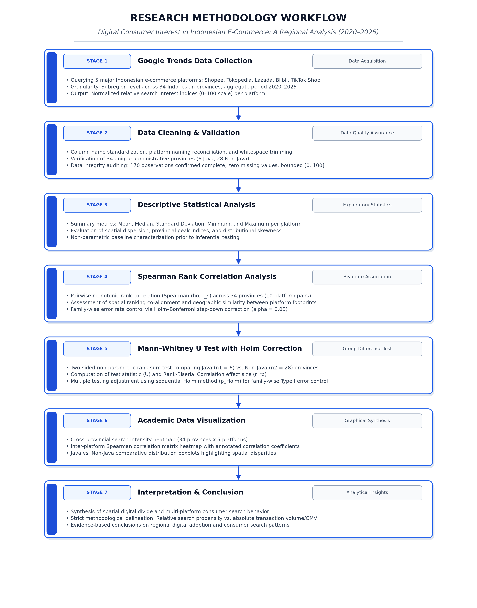

# Digital Consumer Interest in Indonesian E-Commerce: A Google Trends Analysis of Regional Search Patterns, 2020–2025

Repositori ini memuat dokumentasi ilmiah, dataset, kode komputasi, hasil analisis statistik, dan visualisasi lengkap untuk penelitian berjudul:

> **“Digital Consumer Interest in Indonesian E-Commerce: A Google Trends Analysis of Regional Search Patterns, 2020–2025”**

Penelitian ini menganalisis pola spasial minat penelusuran digital (*digital consumer search interest*) masyarakat Indonesia terhadap lima platform *e-commerce* utama: **Shopee, Tokopedia, Lazada, Blibli, dan TikTok Shop** di **34 provinsi** selama periode enam tahun (Januari 2020 – Desember 2025).

---

## DAFTAR ISI
1. [Ringkasan Eksekutif Penelitian](#1-ringkasan-eksekutif-penelitian)
2. [Dataset Mentah 34 Provinsi (170 Observasi)](#2-dataset-mentah-34-provinsi-170-observasi)
3. [Validasi Data & Integritas Metodologi](#3-validasi-data--integritas-metodologi)
4. [Statistik Deskriptif Regional Lengkap](#4-statistik-deskriptif-regional-lengkap)
5. [Analisis Korelasi Peringkat Spearman & Koreksi Multi-Uji Holm](#5-analisis-korelasi-peringkat-spearman--koreksi-multi-uji-holm)
6. [Uji Komparasi Mann–Whitney U: Pulau Jawa vs Luar Jawa](#6-uji-komparasi-mannwhitney-u-pulau-jawa-vs-luar-jawa)
7. [Dominasi Regional & Evaluasi Nilai Seri (Tie-Breaking)](#7-dominasi-regional--evaluasi-nilai-seri-tie-breaking)
8. [Alur Penelitian & Flowchart Metodologi](#8-alur-penelitian--flowchart-metodologi)
9. [Inventarisasi Output & Visualisasi Grafik](#9-inventarisasi-output--visualisasi-grafik)
10. [Batasan Metodologi Ilmiah & Peringatan Interpretasi](#10-batasan-metodologi-ilmiah--peringatan-interpretasi)
11. [Struktur Berkas Workspace](#11-struktur-berkas-workspace)
12. [Panduan Menjalankan Analisis & Replikasi](#12-panduan-menjalankan-analisis--replikasi)

---

## 1. Ringkasan Eksekutif Penelitian

| Parameter Penelitian | Rincian Spesifikasi |
|---|---|
| **Judul Artikel** | *Digital Consumer Interest in Indonesian E-Commerce: A Google Trends Analysis of Regional Search Patterns, 2020–2025* |
| **Objek Kajian** | 5 Platform: Shopee, Tokopedia, Lazada, Blibli, TikTok Shop |
| **Sumber Data** | Google Trends (*Interest by Subregion*) |
| **Rentang Waktu** | 2020–2025 (Akumulasi indeks 6 tahun) |
| **Unit Spasial** | 34 Provinsi di Indonesia (Tingkat administrasi provinsi BPS) |
| **Jumlah Sampel** | $34 \text{ provinsi} \times 5 \text{ platform} = 170 \text{ observasi spasial}$ |
| **Sifat Metrik** | Indeks relatif $[0, 100]$ dinormalisasi independen per platform |
| **Pendekatan Analisis** | Non-parametrik: Statistik Deskriptif, Korelasi Spearman ($r_s$), Mann–Whitney $U$, Koreksi Holm–Bonferroni |
| **Stratifikasi Wilayah** | Pulau Jawa ($n_1 = 6$) vs. Luar Pulau Jawa ($n_2 = 28$) |

---

## 2. Dataset Mentah 34 Provinsi (170 Observasi)

Tabel berikut menyajikan seluruh 170 observasi indeks penelusuran relatif regional yang diperoleh dari Google Trends periode 2020–2025 (Sheet `Regional` pada berkas `data/raw/Dataset E-Commerce.xlsx`):

| No | Provinsi / Wilayah | Kelompok | Shopee | Tokopedia | Lazada | Blibli | TikTok Shop | Platform Dominan (Joint) |
|:---:|---|:---:|---:|---:|---:|---:|---:|---|
| 1 | **Aceh** | Luar Jawa | 57 | 18 | 36 | 29 | 99 | TikTok Shop (99) |
| 2 | **Bali** | Luar Jawa | 54 | 44 | 32 | 54 | 53 | **Shopee & Blibli (Seri 54)** |
| 3 | **Banten** | Jawa | 81 | 68 | 100 | 67 | 92 | Lazada (100) |
| 4 | **Bengkulu** | Luar Jawa | 60 | 20 | 34 | 41 | 71 | TikTok Shop (71) |
| 5 | **DI Yogyakarta** | Jawa | 100 | 56 | 52 | 68 | 78 | Shopee (100) |
| 6 | **DKI Jakarta** | Jawa | 87 | 100 | 95 | 100 | 76 | **Tokopedia & Blibli (Seri 100)** |
| 7 | **Gorontalo** | Luar Jawa | 36 | 15 | 29 | 28 | 90 | TikTok Shop (90) |
| 8 | **Jambi** | Luar Jawa | 57 | 18 | 33 | 30 | 76 | TikTok Shop (76) |
| 9 | **Jawa Barat** | Jawa | 96 | 51 | 97 | 60 | 100 | TikTok Shop (100) |
| 10 | **Jawa Tengah** | Jawa | 88 | 45 | 62 | 42 | 98 | TikTok Shop (98) |
| 11 | **Jawa Timur** | Jawa | 91 | 39 | 50 | 47 | 94 | TikTok Shop (94) |
| 12 | **Kalimantan Barat** | Luar Jawa | 60 | 21 | 24 | 38 | 56 | Bengkulu / TikTok Shop (56) |
| 13 | **Kalimantan Selatan** | Luar Jawa | 75 | 24 | 21 | 33 | 63 | Shopee (75) |
| 14 | **Kalimantan Tengah** | Luar Jawa | 54 | 23 | 28 | 24 | 60 | TikTok Shop (60) |
| 15 | **Kalimantan Timur** | Luar Jawa | 53 | 30 | 30 | 30 | 55 | TikTok Shop (55) |
| 16 | **Kalimantan Utara** | Luar Jawa | 38 | 21 | 36 | 33 | 69 | TikTok Shop (69) |
| 17 | **Kepulauan Bangka Belitung** | Luar Jawa | 66 | 25 | 31 | 36 | 64 | Shopee (66) |
| 18 | **Kepulauan Riau** | Luar Jawa | 69 | 35 | 35 | 57 | 70 | TikTok Shop (70) |
| 19 | **Lampung** | Luar Jawa | 70 | 22 | 48 | 42 | 80 | TikTok Shop (80) |
| 20 | **Maluku** | Luar Jawa | 25 | 12 | 27 | 14 | 38 | TikTok Shop (38) |
| 21 | **Maluku Utara** | Luar Jawa | 32 | 14 | 25 | 17 | 47 | TikTok Shop (47) |
| 22 | **Nusa Tenggara Barat** | Luar Jawa | 54 | 18 | 18 | 30 | 74 | TikTok Shop (74) |
| 23 | **Nusa Tenggara Timur** | Luar Jawa | 25 | 14 | 37 | 23 | 38 | TikTok Shop (38) |
| 24 | **Papua** | Luar Jawa | 21 | 16 | 25 | 16 | 40 | TikTok Shop (40) |
| 25 | **Papua Barat** | Luar Jawa | 22 | 15 | 23 | 20 | 39 | TikTok Shop (39) |
| 26 | **Riau** | Luar Jawa | 62 | 24 | 40 | 40 | 73 | TikTok Shop (73) |
| 27 | **Sulawesi Barat** | Luar Jawa | 38 | 14 | 33 | 34 | 89 | TikTok Shop (89) |
| 28 | **Sulawesi Selatan** | Luar Jawa | 54 | 24 | 33 | 33 | 76 | TikTok Shop (76) |
| 29 | **Sulawesi Tengah** | Luar Jawa | 38 | 15 | 32 | 30 | 79 | TikTok Shop (79) |
| 30 | **Sulawesi Tenggara** | Luar Jawa | 35 | 14 | 28 | 21 | 78 | TikTok Shop (78) |
| 31 | **Sulawesi Utara** | Luar Jawa | 37 | 22 | 29 | 22 | 58 | TikTok Shop (58) |
| 32 | **Sumatera Barat** | Luar Jawa | 59 | 19 | 43 | 40 | 77 | TikTok Shop (77) |
| 33 | **Sumatera Selatan** | Luar Jawa | 69 | 27 | 41 | 35 | 78 | TikTok Shop (78) |
| 34 | **Sumatera Utara** | Luar Jawa | 53 | 24 | 46 | 46 | 62 | TikTok Shop (62) |

---

## 3. Validasi Data & Integritas Metodologi

Pemeriksaan komprehensif terhadap integritas dataset memastikan pemenuhan seluruh kaidah metodologis:

| Aspek Pengujian | Kriteria Ilmiah | Hasil Komputasi | Status |
|---|---|---|:---:|
| **Jumlah Entitas Spasial** | 34 Provinsi di Indonesia | Tepat 34 provinsi teridentifikasi | **Lolos** |
| **Jumlah Platform** | 5 Platform e-commerce utama | Shopee, Tokopedia, Lazada, Blibli, TikTok Shop | **Lolos** |
| **Total Observasi** | $34 \times 5 = 170$ sel | 170 observasi terverifikasi | **Lolos** |
| **Nilai Kosong (*Missing Values*)** | 0 sel | 0 sel (`NaN = 0`), imputasi tidak diperlukan | **Lolos** |
| **Konsistensi Nama Wilayah** | Bebas duplikasi dan sesuai BPS | 34 nama unik terverifikasi | **Lolos** |
| **Batas Interval Nilai** | Rentang $[0, 100]$ | Seluruh nilai berada antara 12 dan 100 | **Lolos** |
| **Sifat Observasi Regional** | Agregat periode 2020–2025 | 1 nilai indeks per platform per wilayah | **Lolos** |

> **Klarifikasi Penting:** Dataset regional ini **bukan** 72 observasi bulanan per provinsi. Deret waktu 72 bulan adalah dataset nasional pada lembar terpisah `Time Series`. Setiap provinsi memiliki tepat satu indeks representatif akumulasi penelusuran selama rentang 2020–2025.

---

## 4. Statistik Deskriptif Regional Lengkap

Statistik deskriptif dihitung pada level agregasi spasial provinsi ($N = 34$ provinsi per platform):

| Platform | N | Mean ($\bar{x}$) | Median ($\tilde{x}$) | Std. Dev. ($s$) | Min | Provinsi Min | Max | Provinsi Max |
|---|---:|---:|---:|---:|---:|---|---:|---|
| **Shopee** | 34 | 56.35 | 55.50 | 21.69 | 21 | Papua | 100 | DI Yogyakarta |
| **Tokopedia** | 34 | 27.85 | 22.00 | 18.44 | 12 | Maluku | 100 | DKI Jakarta |
| **Lazada** | 34 | 39.79 | 33.00 | 20.46 | 18 | Nusa Tenggara Barat | 100 | Banten |
| **Blibli** | 34 | 37.65 | 33.50 | 17.59 | 14 | Maluku | 100 | DKI Jakarta |
| **TikTok Shop** | 34 | 70.29 | 73.50 | 17.79 | 38 | Maluku, NTT | 100 | Jawa Barat |

### Temuan Deskriptif Utama:
1. **TikTok Shop:** Memperoleh nilai mean ($\bar{x} = 70.29$) dan median ($\tilde{x} = 73.50$) tertinggi secara nasional, serta nilai minimum tertinggi ($\min = 38$). Hal ini membuktikan bahwa minat pencarian TikTok Shop terdistribusi merata hingga ke provinsi non-metropolitan di kawasan timur Indonesia.
2. **Shopee:** Berada pada peringkat kedua nasional ($\bar{x} = 56.35, \tilde{x} = 55.50$), menunjukkan stabilitas minat pencarian yang tinggi di seluruh kepulauan, dengan puncak indeks 100 di DI Yogyakarta.
3. **Lazada & Blibli:** Menunjukkan sebaran minat menengah dengan rata-rata masing-masing 39.79 dan 37.65.
4. **Tokopedia:** Memiliki rata-rata nasional terendah ($\bar{x} = 27.85, \tilde{x} = 22.00$), namun mencapai nilai puncak 100 di DKI Jakarta. Pola ini mengindikasikan tingkat konsentrasi spasial yang sangat tajam di pusat perkotaan dan Jawa.

---

## 5. Analisis Korelasi Peringkat Spearman & Koreksi Multi-Uji Holm

Uji korelasi non-parametrik peringkat Spearman ($r_s$) digunakan untuk mengukur derajat keselarasan urutan minat spasial antarplatform lintas 34 provinsi. Nilai $p$ disesuaikan melalui koreksi sekuensial **Holm–Bonferroni** untuk mengendalikan inflasi kesalahan tipe I pada 10 pengujian serentak ($\alpha = 0.05$).

### A. Matriks Korelasi Spearman ($5 \times 5$):
| Platform | Shopee | Tokopedia | Lazada | Blibli | TikTok Shop |
|---|---:|---:|---:|---:|---:|
| **Shopee** | 1.0000 | 0.8102* | 0.6392* | 0.8433* | 0.5772* |
| **Tokopedia** | 0.8102* | 1.0000 | 0.5969* | 0.8132* | 0.2975 |
| **Lazada** | 0.6392* | 0.5969* | 1.0000 | 0.7480* | 0.6017* |
| **Blibli** | 0.8433* | 0.8132* | 0.7480* | 1.0000 | 0.4690* |
| **TikTok Shop** | 0.5772* | 0.2975 | 0.6017* | 0.4690* | 1.0000 |

*\*Korelasi signifikan setelah koreksi Holm ($p_{\text{Holm}} < 0.05$).*

### B. Hasil Uji Signifikansi Berpasangan (10 Pasangan):
| Rank | Pasangan Platform | Spearman Rho ($r_s$) | Raw $p$-value | $p$-value Holm | Signifikan ($\alpha=0.05$) | Interpretasi Spasial |
|:---:|---|---:|---:|---:|:---:|---|
| 1 | **Shopee – Blibli** | **0.8433** | $4.27 \times 10^{-10}$ | $4.27 \times 10^{-9}$ | **Ya** | Keselarasan pola peringkat sangat tinggi |
| 2 | **Tokopedia – Blibli** | **0.8132** | $4.76 \times 10^{-9}$ | $4.28 \times 10^{-8}$ | **Ya** | Jejak sebaran perkotaan sangat identik |
| 3 | **Shopee – Tokopedia** | **0.8102** | $5.90 \times 10^{-9}$ | $4.72 \times 10^{-8}$ | **Ya** | Klaster e-commerce tradisional mapan |
| 4 | **Lazada – Blibli** | **0.7480** | $1.76 \times 10^{-7}$ | $1.23 \times 10^{-6}$ | **Ya** | Keselarasan peringkat kuat |
| 5 | **Shopee – Lazada** | **0.6392** | $4.87 \times 10^{-5}$ | $0.00029$ | **Ya** | Keselarasan peringkat moderat ke kuat |
| 6 | **Lazada – TikTok Shop** | **0.6017** | $0.00015$ | $0.00076$ | **Ya** | Korelasi sebaran moderat |
| 7 | **Tokopedia – Lazada** | **0.5969** | $0.00018$ | $0.00076$ | **Ya** | Korelasi sebaran moderat |
| 8 | **Shopee – TikTok Shop** | **0.5772** | $0.00037$ | $0.00110$ | **Ya** | Korelasi sebaran moderat |
| 9 | **Blibli – TikTok Shop** | **0.4690** | $0.00511$ | $0.01023$ | **Ya** | Korelasi sebaran sedang |
| 10 | **Tokopedia – TikTok Shop** | **0.2975** | **0.08745** | **0.08745** | **Tidak** | **Divergensi spasial unik (tidak berkorelasi)** |

### C. Pembahasan Ilmiah:
1. **Klaster E-Commerce Tradisional (Shopee, Tokopedia, Blibli):**  
   Ketiga platform ini menunjukkan korelasi yang sangat tinggi ($r_s > 0.81, p_{\text{Holm}} < 0.0001$). Hal ini menunjukkan adanya **keselarasan pola peringkat regional yang kuat dan searah (*strong co-directional regional ranking pattern*)**, di mana provinsi yang memiliki infrastruktur internet dan logistik mapan secara konsisten menempatkan ketiga platform ini pada urutan minat teratas.
   > *Peringatan Ilmiah:* Tingginya korelasi $r_s = 0.8433$ antara Shopee dan Blibli **bukan bukti bahwa keduanya memiliki jumlah pembeli, volume penjualan, atau transaksi yang setara**. Korelasi Spearman hanya mengukur kesamaan susunan peringkat geografis.
2. **Divergensi TikTok Shop vs Tokopedia ($r_s = 0.2975, p_{\text{Holm}} = 0.0875$):**  
   TikTok Shop adalah satu-satunya platform yang tidak memiliki hubungan korelasi signifikan dengan Tokopedia. Hal ini menjadi bukti empiris bahwa strategi penetrasi *social commerce* TikTok Shop menjangkau wilayah periferi di luar Pulau Jawa yang tidak terlayani atau kurang aktif dalam penelusuran platform Tokopedia.

---

## 6. Uji Komparasi Mann–Whitney U: Pulau Jawa vs Luar Jawa

Untuk menguji hipotesis disparitas digital antara kawasan barat/metropolitan dengan wilayah kepulauan berkembang, dilakukan uji komparasi peringkat Mann–Whitney $U$ dua sisi antara **Pulau Jawa ($n_1 = 6$)** dan **Luar Pulau Jawa ($n_2 = 28$)**:
- **Provinsi Pulau Jawa:** Banten, DKI Jakarta, Jawa Barat, Jawa Tengah, DI Yogyakarta, Jawa Timur.
- **Provinsi Luar Pulau Jawa:** 28 provinsi lainnya di Indonesia.

| Platform | $n_{\text{Jawa}}$ | $n_{\text{Luar}}$ | Median Jawa | Median Luar Jawa | Statistik $U$ | Raw $p$-value | $p$-value Holm | Rank-Biserial $r_{rb}$ | Signifikan ($\alpha=0.05$) |
|---|---:|---:|---:|---:|---:|---:|---:|---:|:---:|
| **Shopee** | 6 | 28 | 89.50 | 54.00 | 168.0 | 0.00016 | 0.00079 | 1.0000 | **Ya** |
| **Tokopedia** | 6 | 28 | 53.50 | 20.50 | 167.0 | 0.00019 | 0.00079 | 0.9881 | **Ya** |
| **Lazada** | 6 | 28 | 78.50 | 32.00 | 168.0 | 0.00016 | 0.00079 | 1.0000 | **Ya** |
| **Blibli** | 6 | 28 | 63.50 | 31.50 | 162.5 | 0.00042 | 0.00084 | 0.9345 | **Ya** |
| **TikTok Shop** | 6 | 28 | 93.00 | 69.50 | 150.0 | 0.00307 | 0.00307 | 0.7857 | **Ya** |

### Analisis Ukuran Efek (*Effect Size*):
- Seluruh lima platform menunjukkan perbedaan minat penelusuran yang **signifikan secara statistik** ($p_{\text{Holm}} < 0.01$), di mana nilai median di Pulau Jawa selalu lebih tinggi.
- **Shopee dan Lazada ($r_{rb} = 1.0000$):** Menunjukkan pemisahan absolut (*complete rank separation*), di mana semua provinsi di Pulau Jawa memiliki nilai indeks yang lebih tinggi dibandingkan seluruh provinsi di luar Jawa.
- **TikTok Shop ($r_{rb} = 0.7857$):** Menunjukkan disparitas regional terendah di antara seluruh platform. Meskipun minat di Jawa lebih tinggi (median 93.00), median di luar Jawa tetap sangat kuat (69.50), membuktikan efektivitas penetrasi geografis TikTok Shop.

---

## 7. Dominasi Regional & Evaluasi Nilai Seri (Tie-Breaking)

### A. Rekapitulasi Dominasi Regional:
Berdasarkan pendekatan **Dominasi Bersama (*Joint Dominance*)** sebagai standar pelaporan paper ilmiah:

| Platform | Dominasi Bersama (*Joint Dominance*) | Dominasi Terbagi (*Shared*) | Dominasi Bawaan (`idxmax` Bias) | Provinsi Skor Puncak | Skor Puncak |
|---|---:|---:|---:|---|---:|
| **TikTok Shop** | **27 provinsi** | 27.0 | 27 | Jawa Barat | 100 |
| **Shopee** | **5 provinsi** | 4.5 | 5 | DI Yogyakarta | 100 |
| **Blibli** | **2 provinsi (DKI Jakarta & Bali)** | 1.0 | **0** | **DKI Jakarta** | **100** |
| **Tokopedia** | **1 provinsi (DKI Jakarta)** | 0.5 | 1 | DKI Jakarta | 100 |
| **Lazada** | **1 provinsi (Banten)** | 1.0 | 1 | Banten | 100 |
| **Total** | **36\*** | 34.0 | 34 | - | - |

*\*Total berjumlah 36 (> 34 provinsi) karena terdapat 2 provinsi dengan nilai kembar tertinggi.*

### B. Evaluasi Metodologis Khusus Blibli & Penanganan Seri (*Tie*):
1. **Penyebab Blibli Sempat Tercatat 0:**  
   Fungsi bawaan pustaka komputasi `pandas.idxmax()` secara baku hanya memilih kolom pertama yang ditemukan saat terjadi nilai seri. Urutan kolom dalam dataset mentah adalah `[Shopee, Tokopedia, Lazada, Blibli, TikTok Shop]`. Karena nama Blibli berada di belakang Shopee dan Tokopedia, Blibli tereliminasi secara artifisial.
2. **Dua Kasus Nilai Kembar:**
   - **DKI Jakarta:** Tokopedia = 100 dan Blibli = 100. Keduanya secara sah berhak menyandang status indeks pencarian tertinggi di DKI Jakarta.
   - **Bali:** Shopee = 54 dan Blibli = 54. Keduanya secara sah berhak menyandang status indeks pencarian tertinggi di Bali.
3. **Kaidah Pelaporan Ilmiah:** Peneliti wajib melaporkan hasil **Dominasi Bersama (*Joint Dominance*)** secara transparan bahwa Blibli unggul/seri di 2 provinsi, bukan melaporkan angka 0 tanpa catatan.

---

## 8. Alur Penelitian & Flowchart Metodologi

Alur tahapan komputasi dan analisis penelitian disajikan dalam diagram alur komprehensif berikut:



```text
[STAGE 1] Google Trends Data Collection
          │  • 5 Platform e-commerce di Indonesia
          │  • 34 Provinsi (Interest by Subregion), 2020–2025
          │  • Output: Indeks relatif 0–100 per platform
          ▼
[STAGE 2] Data Cleaning & Validation
          │  • Standardisasi nama kolom dan label platform
          │  • Validasi 34 provinsi (6 Jawa, 28 Luar Jawa)
          │  • Audit kelengkapan 170 observasi, 0 nilai hilang
          ▼
[STAGE 3] Descriptive Statistical Analysis
          │  • Central tendency & dispersion: Mean, Median, Std, Min, Max
          │  • Karakterisasi skewness spasial dan puncak minat regional
          ▼
[STAGE 4] Spearman Rank Correlation Analysis
          │  • Korelasi peringkat spasial (r_s) lintas 34 provinsi (10 pasangan)
          │  • Evaluasi keselarasan jejak geografis platform
          │  • Pengendalian Family-Wise Error Rate via koreksi Holm (alpha = 0.05)
          ▼
[STAGE 5] Mann–Whitney U Test with Holm Correction
          │  • Uji komparasi dua kelompok: Jawa (n1 = 6) vs Luar Jawa (n2 = 28)
          │  • Perhitungan statistik U dan ukuran efek Rank-Biserial (r_rb)
          │  • Penyesuaian p-value sekuensial Holm (p_Holm)
          ▼
[STAGE 6] Academic Data Visualization
          │  • Heatmap intensitas minat pencarian 34 provinsi
          │  • Heatmap matriks korelasi Spearman 5x5
          │  • Boxplot komparasi distribusi Jawa vs Luar Jawa
          ▼
[STAGE 7] Interpretation & Conclusion
             • Sintesis disparitas digital dan pola adopsi regional
             • Penegasan batasan: Minat relatif vs volume transaksi/GMV
             • Kesimpulan empiris mengenai kematangan pasar e-commerce
```

---

## 9. Inventarisasi Output & Visualisasi Grafik

Repositori ini menghasilkan berkas visualisasi beresolusi tinggi di direktori [`output_analisis/`](output_analisis/) dan di direktori utama:

| Nama Berkas | Tipe | Deskripsi Konten Visual |
|---|---|---|
| [`research_workflow.png`](research_workflow.png) | PNG (300 DPI) | Flowchart 7 tahap metodologi penelitian lengkap dengan badge, parameter, dan deskripsi ilmiah. |
| [`output_analisis/B2_heatmap_provinsi.png`](output_analisis/B2_heatmap_provinsi.png) | PNG (200 DPI) | Heatmap sebaran intensitas minat pencarian 34 provinsi $\times$ 5 platform diurutkan berdasarkan rata-rata provinsi. |
| [`output_analisis/B7_korelasi_regional.png`](output_analisis/B7_korelasi_regional.png) | PNG (200 DPI) | Heatmap matriks korelasi peringkat Spearman $5 \times 5$ dengan anotasi koefisien korelasi dan palet diverging `RdBu_r`. |
| [`output_analisis/B6_jawa_vs_luar.png`](output_analisis/B6_jawa_vs_luar.png) | PNG | Boxplot perbandingan sebaran indeks minat pencarian antara Pulau Jawa dan Luar Jawa untuk setiap platform. |
| [`output_analisis/B4_boxplot.png`](output_analisis/B4_boxplot.png) | PNG | Boxplot distribusi spasial kelima platform secara nasional. |
| [`output_analisis/B2_ranking_provinsi.png`](output_analisis/B2_ranking_provinsi.png) | PNG | Diagram batang peringkat provinsi untuk setiap platform. |
| [`output_analisis/hasil_analisis_regional.xlsx`](output_analisis/hasil_analisis_regional.xlsx) | Excel | Berkas lembar kerja berisi sheet: `Validasi`, `Statistik_Deskriptif`, `Korelasi_Spearman_Matriks`, `Korelasi_Spearman_Uji`, `Mann_Whitney_Jawa`, `Dominasi_Regional`, dan `Data_Regional_34Prov`. |

---

## 10. Batasan Metodologi Ilmiah & Peringatan Interpretasi

> [!WARNING]
> **Pedoman Penulisan untuk Penulis Paper Ilmiah:**
> 1. **Dilarang Menyamakan Indeks Minat dengan Nilai Penjualan / Transaksi Riil:**  
>    Indeks Google Trends mengukur proporsi minat pencarian digital relatif (*relative search propensity*), bukan nilai transaksi kotor (*Gross Merchandise Value* / GMV), volume pemesanan, atau pangsa pasar finansial (*market share*).
> 2. **Normalisasi Independen Tiap Platform:**  
>    Data setiap platform diekspor secara terpisah dari Google Trends, sehingga masing-masing kolom dinormalisasi secara independen (skala 0–100) terhadap puncak kuerinya sendiri. Indeks 100 pada Blibli di DKI Jakarta hanya bermakna bahwa DKI Jakarta adalah wilayah penyumbang kueri relatif tertinggi bagi Blibli, bukan berarti volume absolut kueri Blibli menyaingi Tokopedia atau TikTok Shop.
> 3. **Bukan Data Bulanan per Provinsi:**  
>    Dataset regional ini terdiri dari tepat **satu nilai indeks agregat per platform per provinsi** (total 170 observasi), bukan 72 observasi bulanan per provinsi.
> 4. **Korelasi Bukan Bukti Persaingan Langsung atau Kausalitas:**  
>    Korelasi Spearman $r_s = 0.8433$ antara Shopee dan Blibli hanya menunjukkan keselarasan urutan geografis (*co-directional ranking pattern*), bukan bukti basis pengguna yang saling tumpang tindih.
> 5. **Kepatuhan Terhadap Ruang Lingkup Metode:**  
>    Penelitian ini **tidak menggunakan** K-Means clustering, PCA, ataupun model regresi. Jangan menambahkan metode yang tidak dilakukan dalam penelitian ini.

---

## 11. Struktur Berkas Workspace

```text
d:\Interest in Indonesian E-Commerce\
├── data\
│   └── raw\
│       └── Dataset E-Commerce.xlsx          # Dataset sumber (Sheet: Regional & Time Series)
├── output_analisis\
│   ├── B2_heatmap_provinsi.png              # Heatmap sebaran regional 34 provinsi
│   ├── B2_ranking_provinsi.png              # Grafik ranking provinsi
│   ├── B4_boxplot.png                       # Boxplot sebaran indeks nasional
│   ├── B6_jawa_vs_luar.png                  # Boxplot perbandingan Jawa vs Luar Jawa
│   ├── B7_korelasi_regional.png             # Heatmap korelasi Spearman 5x5
│   └── hasil_analisis_regional.xlsx         # Seluruh tabel hasil analisis format Excel
├── src\
│   ├── config.py                            # Konfigurasi path, platform, dan direktori
│   ├── data_prep.py                         # Fungsi pembersihan dan validasi data
│   ├── regional_analysis.py                 # Modul analisis komparasi regional
│   └── reporting.py                         # Modul pembantu ekspor laporan
├── notebooks\
│   ├── Analisis_Google_Trends_Ecommerce.ipynb
│   └── Analisis_Google_Trends_Ecommerce_VSCODE_FINAL.ipynb
├── doc.md                                   # Dokumentasi ringkas interpretasi regional
├── research_method_final.md                 # Bab II Research Method bahasa Inggris akademik
├── research_workflow.png                    # Flowchart metodologi penelitian (300 DPI)
├── validation_report.md                     # Laporan audit validasi data lengkap
├── run_regional.py                          # Skrip utama eksekusi analisis regional mandiri
├── validate_dataset.py                      # Skrip validasi ringkas dataset
├── analysis.py                              # Pipeline analisis lengkap
├── requirements.txt                         # Dependensi paket Python
└── README.md                                # Dokumentasi utama repositori terpadu
```

---

## 12. Panduan Menjalankan Analisis & Replikasi

Analisis dapat direproduksi secara mandiri menggunakan Python pada terminal (PowerShell atau Command Prompt):

### 1. Eksekusi Analisis Regional Lengkap
Menghitung validasi, statistik deskriptif, korelasi Spearman, koreksi Holm, uji Mann–Whitney U, evaluasi dominasi bersama, serta memperbarui berkas Excel dan grafik:
```powershell
python run_regional.py
```

### 2. Memeriksa Validasi Integritas Data Regional
```powershell
python validate_dataset.py
```

### 3. Menjalankan Seluruh Pipeline Analisis Terintegrasi
```powershell
python analysis.py
```

---

*Repositori ini dirancang untuk memastikan prinsip transparansi ilmiah, keterlacakan data (*traceability*), dan keterulangan komputasi (*reproducibility*) secara menyeluruh sesuai standar publikasi internasional.*
